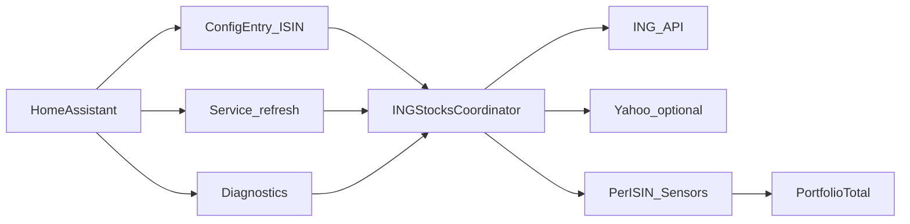
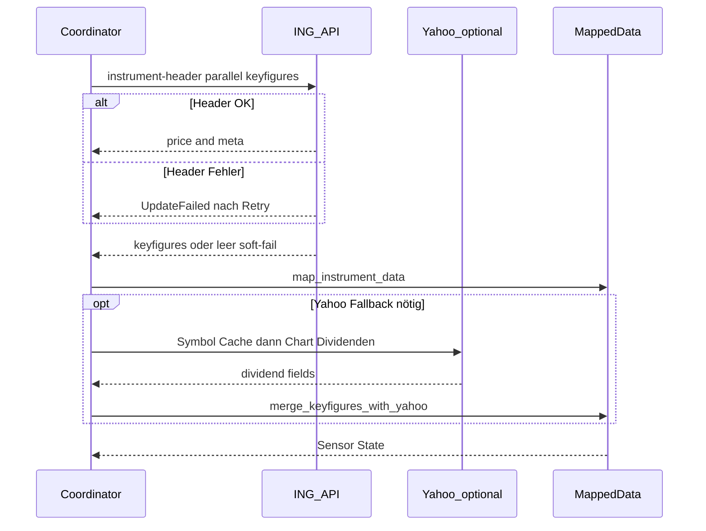
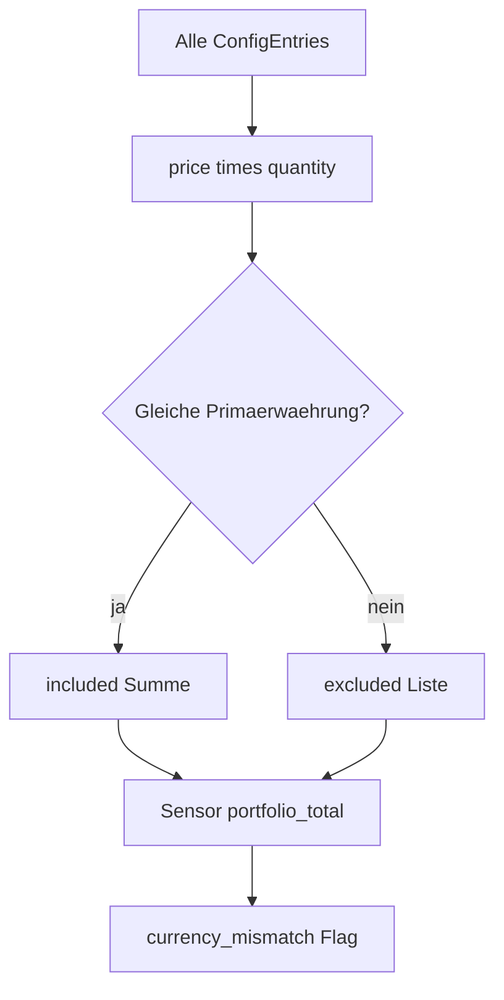

# ING Stocks Plus — Übersicht

Kurze deutschsprachige Übersicht zur Architektur und zum Datenfluss. Installation, Sensorliste und Changelog stehen im englischen [README](../README.md).

## Was macht die Integration?

**ING Stocks Plus** holt Kurs- und Kennzahldaten zu einer **ISIN** über die öffentliche ING Instrument-API und stellt sie in Home Assistant als Sensoren bereit. Optional ergänzt ein **Yahoo-Finance-Fallback** fehlende Dividendenfelder (ohne API-Key). Pro Instrument kannst du eine **Stückzahl** setzen; daraus entstehen Positionswert und ein gemeinsamer **Portfolio-Gesamtwert**.

## Architektur

Pro Config-Entry gibt es einen `INGStocksCoordinator`. Daraus speisen sich die Sensoren je ISIN. Der Portfolio-Sensor summiert alle Positionen. Diagnose und der Service `refresh` greifen auf dieselben Coordinatoren zu.

## Update-Datenfluss

Beim Poll (oder nach `ingstocksplus.refresh`) laufen Header und Keyfigures **parallel**. Der Header ist hart (mit Retry); Keyfigures soft-failen. Fehlen Dividendenfelder und ist Yahoo aktiv, folgt die Chart-/Search-Abfrage — Symbole werden **24 h** gecacht. Das KGV kommt nur von ING.

## Portfolio

Nur Positionen mit Stückzahl **> 0** zählen. Die Summe nutzt die **dominante Währung** (z. B. `€` → `EUR`). Andere Währungen landen unter `excluded`; das Attribut `currency_mismatch` wird gesetzt.

## Einrichtung und Optionen

| Feld | Bedeutung |
|------|-----------|
| ISIN | Pflicht; gegen ING validiert |
| Name | Optional; sonst Name aus der API |
| Scan-Intervall | Minuten zwischen Updates |
| Stückzahl | `> 0` für Positionswert |
| Yahoo-Fallback | Fehlende Dividenden nachladen |
| Marktzeiten-Polling | Außerhalb Xetra/US längeres Intervall (mind. 60 Min.) |

Zusätzlich: leichter **Jitter** (0–30 s) pro Entry, damit viele ISINs nicht gleichzeitig pollen.

## Service und Diagnose

- **`ingstocksplus.refresh`** — alle Instrumente aktualisieren, oder gefiltert über `entry_id` / `isin`
- **Diagnose** am Config-Entry — ISIN, Intervalle, letzter Fehler, Kurz-Portfolio (ohne Secrets)

## Grenzen

- Unoffizielle öffentliche APIs (ING und Yahoo); kein Affiliate von ING
- **KGV** nur von ING; Yahoo-Chart liefert keins — bei ETFs oft leer
- Yahoo Search/Chart kann sich ohne Ankündigung ändern
- Verantwortungsvolle Intervalle wählen (empfohlen: 5–30 Minuten)
